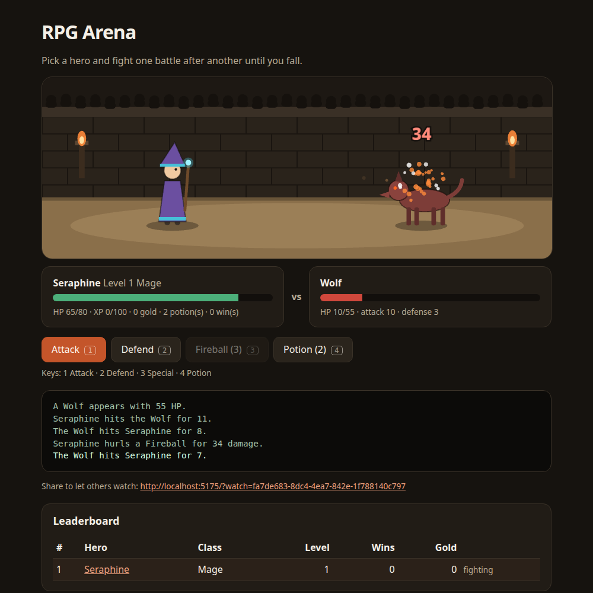

# RPG Arena

A turn-based arena you play in the browser or the terminal. Pick a class and a weapon, then fight one battle after another until your hero falls. Other people can watch a battle live, and the best runs land on the leaderboard.

License: Apache-2.0. Keep `LICENSE` and `NOTICE` if you fork it.
Author: Daniel Llano ([github.com/daniel-llano](https://github.com/daniel-llano))



## How it plays

- Three classes: the Paladin heals, the Ranger fires two arrows, the Mage throws a Fireball that ignores armor.
- Three weapons change attack, speed, or how strong your special is.
- Each turn you Attack, Defend (halves the next hit), use your Special (three-turn cooldown), or drink a Potion.
- Wins give XP, gold, and sometimes a potion. Levels raise your stats and heal you. Enemies get tougher as you level.
- Your hero carries HP and potions from battle to battle, so a run ends when you fall.

## Layout

```
rpg-arena/
├── src/RpgArena.Core   game rules, no dependencies
├── src/RpgArena.Api    minimal API, SignalR hub, SQLite, serves the built web app
├── web/                browser UI: React, TypeScript, Vite, PixiJS
├── src/RpgArena.Cli    the same game in a terminal
├── tests/              engine tests and API integration tests
├── infra/              docker-compose
└── e2e/                Playwright tests
```

Every random roll comes from a small seeded generator stored with the run. A run replays the same way from the same seed, which keeps the engine easy to test.

## Run it

```bash
./scripts/run.sh                          # browser: http://localhost:5175
dotnet run --project src/RpgArena.Cli     # terminal
```

For local work without Docker:

```bash
dotnet run --project src/RpgArena.Api     # API on http://localhost:5175, docs at /docs
cd web && npm install && npm run dev      # UI on http://localhost:5176, proxies /api and /hubs
```

`npm run build` writes the UI into `src/RpgArena.Api/wwwroot`, so the API serves it on one origin. The Dockerfile does the same.

## Browser UI

The page is React and TypeScript, built with Vite. Forms, buttons, health bars, the log and the leaderboard are plain HTML, so they work with a keyboard and a screen reader. The arena above them is drawn with [PixiJS](https://pixijs.com) 8. The heroes and monsters are vector shapes drawn in code, so there are no image assets.

After every turn the stage reads the new log lines and animates them: sword lunges, arrows, magic bolts, the Fireball, Holy Light, potions, guard, crits, level ups, and the fall. Spectators see the same animations over SignalR. PixiJS loads in its own chunk after the page is up. If WebGL isn't available, or the player asks for reduced motion, the stage stays still and nothing else changes.

Keys during a battle: `1` Attack, `2` Defend, `3` Special, `4` Potion.

Why this stack: the game state lives on the server and changes once per turn, so the UI is mostly forms and panels, which suits React. A full game framework like Phaser brings physics, scenes and input handling that a turn-based fight doesn't need. PixiJS is only a renderer, so it sits inside one React component and draws the arena.

## API

| Method | Path | Notes |
|--------|------|-------|
| GET | `/api/catalog` | Classes and weapons |
| POST | `/api/runs` | `{ heroName, heroClass, weapon }`. Returns the run and a token |
| GET | `/api/runs/{id}` | Current state, anyone with the id can read it |
| POST | `/api/runs/{id}/actions` | `{ action: Attack \| Defend \| Special \| Potion }`, needs `X-Run-Token` |
| POST | `/api/runs/{id}/next` | Next battle after a win, needs `X-Run-Token` |
| GET | `/api/leaderboard?top=10` | By level, then wins, then gold |
| WS | `/hubs/battle` | Call `Watch(runId)` and listen for `state` |

Only the token's SHA-256 hash is stored. Two actions racing on the same run can't both apply, the second gets 409.

## Configuration

| Key | Notes |
|-----|-------|
| `ConnectionStrings:Arena` | SQLite file. The container keeps it in the `/data` volume |
| `RateLimiting:StartsPerMinute`, `RateLimiting:ActionsPerMinute` | Per IP, default 20 and 240 |
| `ForwardedHeaders:KnownProxies`, `ForwardedHeaders:KnownNetworks` | IPs and CIDR ranges of the reverse proxies allowed to set `X-Forwarded-For` and `-Proto`. Empty means loopback only |
| `EnableApiDocs` | Serves `/openapi/v1.json` and `/docs` outside Development |

## Tests

```bash
./scripts/test.sh   # engine and API tests (temp SQLite, SignalR), then web typecheck, tests and build
./scripts/e2e.sh    # Docker + Playwright
```

See [TESTING.md](TESTING.md).
