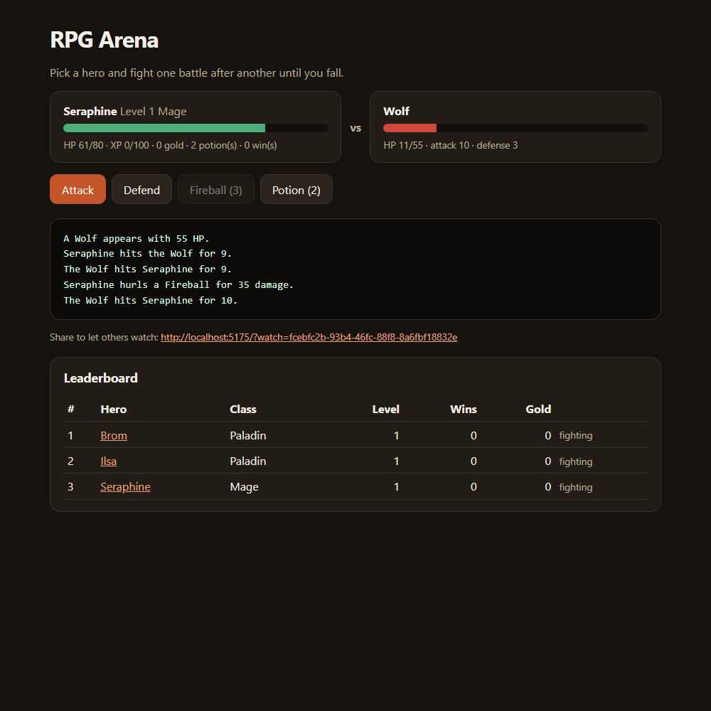

# RPG Arena

A turn-based arena you play in the browser or the terminal. Pick a class and a weapon, then fight one battle after another until your hero falls. Other people can watch a battle live, and the best runs land on the leaderboard.

License: Apache-2.0. Keep `LICENSE` and `NOTICE` if you fork it.
Author: Daniel Llano ([github.com/daniel-llano](https://github.com/daniel-llano))



## How it plays

- Three classes: the Paladin heals, the Ranger fires two arrows, the Mage throws a Fireball that ignores armor.
- Three weapons change attack, speed, or how strong your special is.
- Each turn you Attack, Defend (halves the next hit), use your Special (three-turn cooldown), or drink a Potion.
- Wins give XP, gold, and sometimes a potion. Levels raise your stats and heal you. Enemies get tougher as you level.
- Your hero carries HP and potions from battle to battle, so a run ends when you fall.

## Layout

```
rpg-arena/
├── src/RpgArena.Core   game rules, no dependencies
├── src/RpgArena.Api    minimal API, SignalR hub, SQLite, browser UI in wwwroot
├── src/RpgArena.Cli    the same game in a terminal
├── tests/              engine tests and API integration tests
├── infra/              docker-compose
└── e2e/                Playwright tests
```

Every random roll comes from a small seeded generator stored with the run. A run replays the same way from the same seed, which keeps the engine easy to test.

## Run it

```bash
./scripts/run.sh                          # browser: http://localhost:5175
dotnet run --project src/RpgArena.Cli     # terminal
```

For local work without Docker: `dotnet run --project src/RpgArena.Api`. The API reference is at `/docs` in Development.

## API

| Method | Path | Notes |
|--------|------|-------|
| GET | `/api/catalog` | Classes and weapons |
| POST | `/api/runs` | `{ heroName, heroClass, weapon }`. Returns the run and a token |
| GET | `/api/runs/{id}` | Current state, anyone with the id can read it |
| POST | `/api/runs/{id}/actions` | `{ action: Attack \| Defend \| Special \| Potion }`, needs `X-Run-Token` |
| POST | `/api/runs/{id}/next` | Next battle after a win, needs `X-Run-Token` |
| GET | `/api/leaderboard?top=10` | By level, then wins, then gold |
| WS | `/hubs/battle` | Call `Watch(runId)` and listen for `state` |

Only the token's SHA-256 hash is stored. Two actions racing on the same run can't both apply, the second gets 409.

## Configuration

| Key | Notes |
|-----|-------|
| `ConnectionStrings:Arena` | SQLite file. The container keeps it in the `/data` volume |
| `RateLimiting:StartsPerMinute`, `RateLimiting:ActionsPerMinute` | Per IP, default 20 and 240 |
| `EnableApiDocs` | Serves `/openapi/v1.json` and `/docs` outside Development |

## Tests

```bash
./scripts/test.sh   # engine tests + API tests on a temp SQLite file (including SignalR)
./scripts/e2e.sh    # Docker + Playwright
```

See [TESTING.md](TESTING.md).
